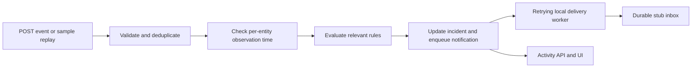

# Intraday

A small notification system for support team leads: configure a rule, preview it against a busy morning, and see exactly why an alert reached its recipient.

**TypeScript · React · Express · SQLite.** Real rule evaluation and durable state; local delivery stubs.

## Run it

Requires **Node.js 22.13+** and npm. No database service, credentials, or environment file needed.

```sh
npm ci
npm run dev
```

Open **http://localhost:3000**. Three example rules are created on the first run. The **Overview** is the landing page. Press **Run demo** to populate active issues and recent alerts immediately. Open the arrow beside it for optional step-by-step replay controls.

For a production build:

```sh
npm run build
npm start
```

Rules, incidents, deliveries, and the replay cursor persist in `data/intraday.sqlite`. Restarting leaves replay paused at its last committed event. **Reset demo** clears event and notification history while preserving your rules. `PORT` and `DB_PATH` can override the defaults; `DB_PATH=:memory:` starts an ephemeral workspace. The server binds to localhost.

Prefer the terminal? `npm run replay` evaluates the sample in an isolated, in-memory database and prints notifications and processing diagnostics. It never changes the browser workspace.

## A three-minute demo

1. Start on **Overview**. **Needs attention** shows active issues, **Rules** summarizes enabled/paused configuration, and **Recent alerts** shows the latest notifications. Select an issue or alert to open its evidence in Activity. Open **Rules** to manage configuration.
2. Select **Create rule**. Choose a condition, queues, and recipient. Names are generated automatically; expand **Rule name** to customize one. **Test with sample** shows how many alerts it would produce without changing Activity.
3. Select **Run demo**. The app evaluates the sample morning and returns to **Overview** with the results. Select an alert to open **Activity**. Expand an alert to see why it fired and its latest update. Delivery receipts and event IDs are under **Delivery & event details**.
4. For a slower walkthrough, open the arrow beside **Run demo** to play, pause, or step through events. **View event log** shows duplicate/conflict handling and missing data.
5. Edit a rule by selecting its name, or use its three-dot menu. **Reset demo** keeps your rules and clears the sample history so you can try again.

With the original three rules, the expected opening alerts are:

| Event time (UTC) | Rule                              | Evidence                    | Recipient / stub |
| ---------------- | --------------------------------- | --------------------------- | ---------------- |
| 09:30            | Billing SLA breached              | 130s oldest wait > 120s SLA | Maya / Slack     |
| 09:36            | Billing backlog above 20          | 22 tickets > 20             | Maya / In-app    |
| 09:45            | Agent out of adherence for 10 min | a_19 reaches 10 minutes     | Jordan / Slack   |
| 10:15            | Agent out of adherence for 10 min | a_88 observed at 15 minutes | Jordan / Slack   |

At the end, three incidents are resolved; a_88’s adherence incident remains active **as of its last observation at 10:30**. Repeated matches update the incident without sending more alerts. No real Slack or email messages are sent.

## Product choices

**Audience: team leads.** Queue coverage and agent adherence give leads specific actions: rebalance staffing, investigate a schedule mismatch, or coordinate help. Agent self-notifications and executive digests need different routing and timing experiences, so they are deferred.

**Three templates instead of a general rules language.** Users select SLA breach, backlog, or adherence; choose queues, thresholds, a named demo recipient, and a channel. This covers useful workflows while keeping configuration understandable. Agents are scoped by the queues in each adherence observation. The demo queue and recipient catalogs are intentionally fixed.

**One opening alert per incident.** A sustained problem stays visible without repeated pings. Resolution appears in the inbox; it does not send another notification. Different rules remain independent because they can represent different recipients and actions. There is no cross-rule suppression.

**Preview before saving.** The sample is useful evidence, not a claim about future alert volume. Preview always evaluates the draft as enabled in its own database, across the entire sample. Saving a rule only affects future fresh observations.

**Observation-based duration.** Adherence uses `violation_started_at`; it fires at the first fresh check at or beyond the duration. A missing start time cannot establish duration. The sample has large observation gaps, so the app never infers recovery from silence. Long-call alerts would need timers and stale-state handling to fire during calls; they are deferred rather than approximated from completed-call durations.

No digests, arbitrary expressions, escalation chains, forecast-based alerts, delivery integrations, auth, or tenancy plumbing. No cooldown or hysteresis: a healthy observation resolves an incident, and a subsequent breach can alert again. Stabilization windows would be the next addition for flapping metrics.

## How it works



Event acceptance, latest state, incident changes, outbox entries, and replay cursor advancement share one SQLite transaction. A partial unique index enforces one active incident per rule/entity. The pure evaluator contains domain decisions; storage owns lifecycle and atomicity; replay is only an event source.

The outbox freezes the opening evidence, recipient, channel, and rule name. A synchronous local adapter inserts into a durable inbox using the notification ID as an idempotency key. Delivery is attempted after ingestion and by a worker every two seconds. A failed delivery stays pending with its attempt count and error. A restart retries pending work. A send-before-ack failure cannot duplicate this stub’s inbox entry; an external provider would need its own idempotency support.

Read the [behavior contract](docs/decisions.md) for exact semantics and [architecture notes](docs/architecture.md) for the schema, boundaries, and production evolution.

### Data quality policy

The feed contains 96 arrival records. The default replay produces **93 accepted, 1 conflict, 1 stale, and 1 unknown-duration outcome**, with no invalid records.

- An identical event-ID retry is ignored. A changed payload under the same ID is a conflict; the first payload wins.
- A distinct event at or before the latest timestamp for the same entity **and event type** is retained but cannot change current state. The final VIP snapshot is deliberately stale. Equal-time distinct records also follow this policy because the source provides no sequence number.
- Null forecasts are valid and do not block SLA/backlog evaluation. Null queue membership is unknown, not a reused previous assignment. Empty membership is valid and represents no assigned queues.
- Missing adherence start time preserves incident state. A fresh adherence check that explicitly moves an agent outside the rule’s queues closes its incident as “Agent left selected queues,” rather than calling it a recovery.
- Invalid timestamps, negative counters, or malformed records produce receipts and do not halt the replay. JSONL is never sorted to hide arrival problems.

## Verify it

```sh
npm test                 # domain, lifecycle, persistence, and HTTP integration
npm run build            # strict TypeScript checks + production client build
npm run format:check
npm run replay           # isolated sample replay and expected notifications
```

Browser checks run against a production build with an isolated in-memory database on port 3100:

```sh
npx playwright install chromium
npm run test:e2e
```

If Google Chrome is already installed, use `PLAYWRIGHT_CHANNEL=chrome npm run test:e2e` instead of downloading Chromium. Screenshots and failure traces go to ignored `test-results/`.

Tests cover exact threshold boundaries, incident suppression/recovery/recurrence, queue and agent isolation, recipient routing, deduplication/conflicts, stale observations, missing evidence, dynamic scope, transactional rollback, durable restart, and retry after a simulated send-before-ack failure. The fixture test asserts exact alert evidence and all processing totals. Browser checks exercise configuration, validation, preview, playback, notification evidence, recipient filtering, editing/deletion, reset, keyboard focus, reduced motion, and layouts at 375/768/1024/1440px. Verification used Node 26.9 and headless Chrome.

## Repository guide

| File                    | Responsibility                                                        |
| ----------------------- | --------------------------------------------------------------------- |
| `server/domain.ts`      | Event/rule schemas, demo catalogs, pure evaluation                    |
| `server/store.ts`       | SQLite schema, atomic ingestion, incident lifecycle, outbox and inbox |
| `server/replay.ts`      | Arrival-order replay with durable cursor                              |
| `server/app.ts`         | HTTP API, request validation, isolated preview                        |
| `server/index.ts`       | Server startup, client serving, retry worker, shutdown                |
| `src/Overview.tsx`      | Active issues, recent alerts, and rule summary                        |
| `src/RuleEditor.tsx`    | Condition selection, generated names, validation, sample preview      |
| `src/RuleCard.tsx`      | Rule summaries and controls                                           |
| `src/ActivityInbox.tsx` | Routing receipts and incident evidence                                |
| `src/ProcessingLog.tsx` | Event outcomes and data issues                                        |
| `tests/`                | Engine/API tests and browser workflows                                |

### HTTP API

| Method | Path                 | Purpose                                                                                         |
| ------ | -------------------- | ----------------------------------------------------------------------------------------------- |
| GET    | `/api/state`         | Rules, recent activity, observations, processing totals, replay state                           |
| POST   | `/api/rules`         | Create a validated rule                                                                         |
| PUT    | `/api/rules/:id`     | Replace configuration; increment revision                                                       |
| DELETE | `/api/rules/:id`     | Delete rule; retain historical notifications                                                    |
| POST   | `/api/preview`       | Evaluate a rule body in isolation                                                               |
| POST   | `/api/events`        | Ingest one event from the supplied schemas                                                      |
| GET    | `/api/notifications` | Recent notification records, including pending status                                           |
| POST   | `/api/replay`        | `{ "action": "play" }`, `pause`, `step`, `finish`, `reset`, or `speed`; optional rate: 2, 4, 12 |

For example, ingest the first sample record with `head -n 1 events.jsonl | curl -sS -H 'Content-Type: application/json' --data-binary @- http://localhost:3000/api/events`. Repeating it demonstrates idempotency. Manual ingestion shares the workspace; reset before reproducing fixture outcomes.

## AI assistance

OpenAI Codex helped scope the product, inspect the fixture, implement the code and tests, refine the UI, and draft this writeup. Its local UI/UX skill informed interface checks. Verification included strict compilation, transactional failure tests, exact sample replay assertions, browser workflows, visual inspection of generated screenshots, and a dependency audit. The audit identified an issue in the initial validation dependency; the implementation was updated to a patched release and retested. No external AI-generated imagery or hosted app builder was used.
